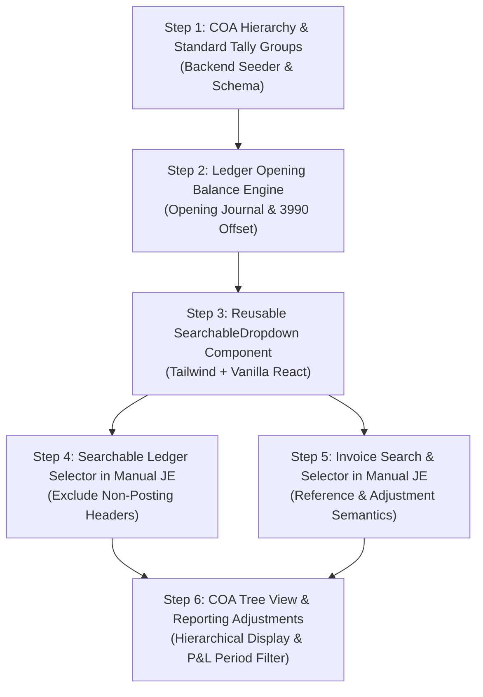

# ACCOUNTING WORKFLOW GAP ANALYSIS & ARCHITECTURE AUDIT
## Chart of Accounts, Groups, Ledgers, Opening Balances, Journal Entries & Invoice References

**Repository:** `C:\Users\AkhileshSoni\Desktop\veridexoneDoc\TallyVeridexERP`  
**Phase:** 1 — Read-Only Accounting Workflow Audit  
**Audit Status:** Completed  
**Execution Mode:** Strictly Read-Only (Zero Code/Data Mutations)  
**Date:** October 2026  

---

## 1. Executive Summary

A comprehensive read-only audit was conducted on the TallyVeridexERP application to evaluate its actual implementation against standard Tally-style and Indian Commercial ERP accounting workflows. The audit inspected the full frontend-to-backend pipeline: React views, API services, Express routes, controllers, Mongoose schemas, double-entry posting services, reporting engines, seed utilities, and automated test suites.

### Key Audit Findings:
1. **Core Double-Entry & Transaction Engines are Strong**: The general ledger posting engine (`journalPostingService.js`), inventory valuation, commercial GST calculation (`gstTaxService.js`), period lock enforcement (`FiscalPeriod.js`), and commercial document lifecycle (`commercialPostingService.js`, `commercialReversalService.js`) are functionally robust, transactional, and tenant/company-isolated.
2. **Account Groups & Hierarchy are Incomplete**: There is **no separate `AccountGroup` model**. While `LedgerAccount` contains a `parent_account_id` field in its schema, it is completely omitted in the frontend creation modal, never populated in default seeds (`seedCoa.js`), and never rendered hierarchically in the Chart of Accounts table (which displays as a flat, un-indented list).
3. **General Ledger Opening Balances are Missing**: There is **no mechanism to enter or persist opening balances** for general ledger accounts upon ledger creation or editing. `LedgerAccount` has no `opening_balance` field. Setting balances directly on `current_balance` would cause severe double-counting and throw the Trial Balance out of equilibrium.
4. **Manual Journal Entry Ledger Selection is Primitive**: The Manual Journal voucher modal in `GLWorkspacePage.jsx` uses a native, non-searchable HTML `<select>` dropdown. It does not support typeahead search, does not filter out non-posting summary header accounts, and would become unusable with a large Chart of Accounts.
5. **Invoice Reference in Manual Journals is a Blind Text Input**: The `reference_id` in the manual journal form is an unverified `<input type="text">`. There is no searchable invoice picker, no party/date/amount/balance display, no database verification, no persistent linkage to `CommercialDocument`, and no distinction between a passive document reference, an invoice adjustment, or a bill-wise settlement.

---

## 2. Existing Data Model & Accounting Architecture

### 2.1 Models Inspected

| Model | File Path | Key Fields & Roles | Audit Observations |
| :--- | :--- | :--- | :--- |
| **`LedgerAccount`** | [`backend/src/models/LedgerAccount.js`](file:///C:/Users/AkhileshSoni/Desktop/veridexoneDoc/TallyVeridexERP/backend/src/models/LedgerAccount.js) | `tenant_id`, `company_id`, `account_code`, `account_name`, `account_type`, `normal_balance`, `parent_account_id`, `is_posting_allowed`, `current_balance`, `subledger_type`, `status` | Contains `parent_account_id` (ref `LedgerAccount`) and `is_posting_allowed`, but **NO `opening_balance` field**. Unique index on `{ tenant_id, company_id, account_code }`. |
| **`Journal`** | [`backend/src/models/Journal.js`](file:///C:/Users/AkhileshSoni/Desktop/veridexoneDoc/TallyVeridexERP/backend/src/models/Journal.js) | `tenant_id`, `company_id`, `journal_number`, `posting_date`, `fiscal_period_id`, `source_module`, `reference_id`, `memo`, `total_debit`, `total_credit`, `status` | `reference_id` is a loose `String` (e.g. `"INV-001"`). No ObjectId foreign key to `CommercialDocument`. `status`: `DRAFT`, `VALIDATED`, `POSTED`, `REVERSED`. |
| **`JournalEntry`** | [`backend/src/models/JournalEntry.js`](file:///C:/Users/AkhileshSoni/Desktop/veridexoneDoc/TallyVeridexERP/backend/src/models/JournalEntry.js) | `tenant_id`, `company_id`, `journal_id`, `line_number`, `ledger_account_id`, `account_code`, `debit`, `credit`, `memo`, `dimensions` | Double-entry line item. Stores both `ledger_account_id` (ObjectId) and `account_code` (String). Balanced debits and credits enforced by service. |
| **`CommercialDocument`** | [`backend/src/models/CommercialDocument.js`](file:///C:/Users/AkhileshSoni/Desktop/veridexoneDoc/TallyVeridexERP/backend/src/models/CommercialDocument.js) | `document_type`, `document_number`, `party_id`, `grand_total`, `amount_paid`, `balance_due`, `journal_id`, `linked_source_document_id`, `status` | Primary commercial invoice/voucher entity (`SALES_INVOICE`, `PURCHASE_INVOICE`, `CREDIT_NOTE`, `DEBIT_NOTE`, etc.). Tracks `journal_id` (GL posting) and `balance_due`. |
| **`BillAllocation`** | [`backend/src/models/BillAllocation.js`](file:///C:/Users/AkhileshSoni/Desktop/veridexoneDoc/TallyVeridexERP/backend/src/models/BillAllocation.js) | `payment_document_id`, `invoice_document_id`, `allocated_amount`, `status` | Tracks settlement allocations between payments/receipts and invoices. Used in commercial receipts/payments, but **not connected to manual JEs**. |
| **`FiscalPeriod`** | [`backend/src/models/FiscalPeriod.js`](file:///C:/Users/AkhileshSoni/Desktop/veridexoneDoc/TallyVeridexERP/backend/src/models/FiscalPeriod.js) | `period_name`, `fiscal_year`, `period_number`, `start_date`, `end_date`, `status` (`OPEN`, `SOFT_CLOSED`, `HARD_CLOSED`, `LOCKED`) | Protects against backdated postings to closed periods. Checked in `postJournalEntry`. |

---

## 3. Detailed Audit by Requirement

### 3.1 Chart of Accounts & Account Group Hierarchy

| Audit Question | Actual Implementation Finding | Status |
| :--- | :--- | :--- |
| **1. Separate Group & Ledger entities?** | **No.** There is no `AccountGroup` model in `backend/src/models/`. Both groups (summary headers) and posting ledgers are intended to share the `LedgerAccount` schema, distinguished only by `is_posting_allowed: false` (group) vs `true` (ledger). | **PARTIAL / ARCHITECTURAL GAP** |
| **2. Parent-child hierarchy supported?** | **Partially in schema, but dormant in practice.** `LedgerAccount.schema` has `parent_account_id: { type: ObjectId, ref: 'LedgerAccount' }`. However, `seedCoa.js` seeds all 28 accounts as flat root accounts (`parent_account_id: null`). | **PARTIAL** |
| **3. Can ledger be assigned to parent group?** | **Backend yes, Frontend no.** `createAccount` in `glController.js` validates `parent_account_id` if passed. But `updateAccount` in `glController.js` ignores `parent_account_id`. The frontend modal has **no input** for it. | **BROKEN IN UI** |
| **4. Does creation form load available groups?** | **No.** `newAccountForm` in `GLWorkspacePage.jsx` does not query or list parent accounts/groups. | **MISSING** |
| **5. Selector type (dropdown, searchable, free text)?** | **Non-existent.** No field exists on the UI form for parent group selection. | **MISSING** |
| **6. Distinguish parent groups, subgroups, ledgers?** | **No.** In Tally, there are 28 predefined Primary Groups (e.g., *Current Assets*, *Sundry Debtors*, *Duties & Taxes*). In this codebase, only 5 broad `account_type` enums exist (`ASSET`, `LIABILITY`, `EQUITY`, `REVENUE`, `EXPENSE`). | **MISSING** |
| **7. Account code/name uniqueness?** | Unique index exists for `{ tenant_id, company_id, account_code }`. `account_name` is **not** validated for uniqueness (duplicate account names can be created). | **PARTIAL** |
| **8. Hierarchy rendered in COA reports?** | **No.** `GLWorkspacePage.jsx` renders a flat `<table>` sorted by `account_code`. No tree view, indentation, expandable nodes, or parent group aggregations exist. | **MISSING** |

---

### 3.2 Ledger Creation & Opening Balances

| Audit Item | Current Implementation | Risk / Impact | Status |
| :--- | :--- | :--- | :--- |
| **Ledger Form Fields** | Code, Name, Category (`account_type`), Normal Balance (`DEBIT`/`CREDIT`), Texas § 4053 Fiduciary checkbox. | Missing: Parent Group, Description, Opening Balance amount, Opening Dr/Cr, Opening Date/FY, Subledger Type. | **PARTIAL** |
| **Opening Balance Storage** | **None.** No `opening_balance` field exists in `LedgerAccount`. Only `current_balance` exists, which is dynamically mutated by `postJournalEntry`. | Severe risk: directly altering `current_balance` corrupts auditability and bypasses the double-entry journal ledger. | **MISSING** |
| **General Ledger Integration** | GL drilldown queries `JournalEntry.find({ ledger_account_id })`. | Any balance not created via a `JournalEntry` is invisible in the ledger transaction history. | **BROKEN** |
| **Trial Balance Integration** | `computeTrialBalance` in `journalPostingService.js` reads `acc.current_balance` for ending balances, but reads `JournalEntry` for period debits/credits. | If an opening balance is manually injected into `current_balance`, ending debits will not match ending credits unless an offset account is credited/debited. | **HIGH RISK** |
| **Balance Sheet Integration** | `generateFinancialReports` in `financeCloseService.js` reads `acc.current_balance`. | Balance Sheet will reflect the balance, but will be out of equilibrium (`total_assets != total_liabilities_and_equity`) without a balanced entry. | **HIGH RISK** |
| **Profit & Loss Contamination** | `generateFinancialReports` reads `acc.current_balance` for `REVENUE` and `EXPENSE` accounts without period boundary filtering. | If an opening balance were entered on a P&L account, it would directly distort current-period Net Income! | **CRITICAL RISK** |
| **Double Counting Risk** | If a user enters an opening balance directly on `LedgerAccount.current_balance` AND later posts an Opening Journal Entry, `current_balance` will be incremented twice! | Single source of truth is currently undefined. | **CRITICAL RISK** |

> [!IMPORTANT]
> **Single Source of Truth for Opening Balances:**
> In double-entry accounting, an opening balance must **never** be a raw disconnected number. The single source of truth must be an **Opening Balance Journal Entry** (`source_module: 'OPENING_BALANCE'`) balanced against **Opening Balance Offset / Valuation Reserve (`3990`)** or **Retained Earnings (`3000`)**.
> 
> *Proof in existing codebase:* Notice how opening stock was properly implemented in [`openingStockGlService.js`](file:///C:/Users/AkhileshSoni/Desktop/veridexoneDoc/TallyVeridexERP/backend/src/services/openingStockGlService.js):
> - Debit `1201` (Stock-in-Hand / Inventory Asset)
> - Credit `3990` (Opening Stock Offset / Valuation Reserve)
> General ledger account opening balances must follow this exact same balanced double-entry architecture.

---

### 3.3 Manual Journal Entry — Ledger Selection

| Audit Item | Current Implementation in `GLWorkspacePage.jsx` | Audit Finding |
| :--- | :--- | :--- |
| **Selector UI Component** | Native `<select>` tag (`lines.map(...)` rendering `<option value={acc.account_code}>`). | **Non-searchable.** Users must scroll through the dropdown. In browsers, typing only jumps to the first character. |
| **Data Source & Scope** | Fetches `/api/v1/gl/accounts` scoped to active tenant and company context. | Correctly scoped to company, but loads all accounts into client memory. |
| **Display Format** | `{acc.account_code} - {acc.account_name}` | Usable for small COAs, but lacks account group or category context. |
| **Saved Value** | Saves `line.account_code` (String). | Backend `postJournalEntry` resolves `account_code` to `LedgerAccount` record within company scope. |
| **Non-Posting Header Filtering** | **None in UI.** Accounts with `is_posting_allowed: false` are rendered in the `<select>`. | If selected, backend rejects with error: `Account "X" is a summary/parent header and does not allow direct postings`. |
| **Inactive Account Filtering** | `/api/v1/gl/accounts` returns all accounts; UI does not filter out `status === 'INACTIVE'`. | Backend correctly rejects with error: `Account is inactive and cannot accept postings`. |
| **Validation** | Live client preview validates that Total Debits == Total Credits and amounts are positive. | Good. Backend `postJournalEntry` uses `BigNumber.js` for strict equilibrium check. |
| **Large COA Scalability** | Client-side rendering of all options in each line of the modal. | Poor. For enterprises with 1,000+ ledgers, 10 journal lines will render 10,000 `<option>` DOM elements, causing UI lag. |

---

### 3.4 Already-Raised Invoice References in Manual Journal Entry

The audit evaluated how manual journal entries reference or interact with already-posted invoices (`CommercialDocument`):

```
       Current Implementation:
       [New Journal Modal] ---> [Reference ID: text input] ---> Journal.reference_id (raw string)
                                                                 |
                                                                 x (NO database link, NO verification,
                                                                    NO invoice lookup, NO balance adjustment)
```

| Audit Item | Current Implementation | Audit Finding |
| :--- | :--- | :--- |
| **Search by invoice number?** | **No.** Only a raw text input `<input type="text" placeholder="e.g. INV-2026-0001">`. | **MISSING** |
| **Search by party/customer?** | **No.** No counterparty selector or filter exists in the journal modal. | **MISSING** |
| **Display invoice details?** | **No.** Invoice date, customer, grand total, balance due, and status are not fetched or shown. | **MISSING** |
| **Persistent foreign key?** | **No.** `Journal` schema only has `reference_id: { type: String }`. There is no `commercial_document_id` or `invoice_id` field. | **MISSING** |
| **Existence Validation?** | **No.** The user can type any string (e.g. `"FOOBAR-999"`), and `postJournal` accepts it without verifying if the invoice exists. | **BROKEN** |
| **Invoice Status Rules?** | **No.** No check whether the referenced invoice is `POSTED`, `DRAFT`, or `CANCELLED`. | **MISSING** |
| **Click to View Linked Invoice?** | **No.** Journals in the list view show `reference_id` as text, but it is not a clickable link to open the invoice. | **MISSING** |

#### Three Distinct Accounting Semantics Identified:

1. **Semantic A — Passive Document Reference (Traceability Only):**
   - *Use Case:* General journal entry referencing an invoice for narration/audit purposes (e.g., booking an auditor's adjustment or cross-reference).
   - *Requirement:* Search and select an existing `CommercialDocument` (must be `POSTED`). Store `commercial_document_id` on the `Journal`. Render clickable link to invoice. **Do not modify invoice balance**.
2. **Semantic B — Commercial Invoice Adjustment (Debit/Credit Notes):**
   - *Use Case:* Price correction, return, rebate, discount, or bad-debt write-off against an already-posted invoice.
   - *Current Status:* Partially supported via `CommercialDocument` with `document_type: 'CREDIT_NOTE'` or `'DEBIT_NOTE'`, but currently lacking a selector to choose `linked_source_document_id`.
   - *Requirement:* Adjusting an invoice must update the source document's `balance_due` and link via `linked_source_document_id` or an Adjustment link.
3. **Semantic C — Bill-Wise Settlement / Payment Allocation:**
   - *Use Case:* Settling an outstanding invoice with cash, bank, or customer advance.
   - *Current Status:* Supported in commercial payments via [`BillAllocation.js`](file:///C:/Users/AkhileshSoni/Desktop/veridexoneDoc/TallyVeridexERP/backend/src/models/BillAllocation.js) and `commercialPostingService.js`, but **not available in manual Journal vouchers**.

---

### 3.5 Searchable Dropdown Audit Across Masters

| Master Selector | Target Entity | Current UI Control | Search / Typeahead | Stable Value Saved | Refresh on Company Switch |
| :--- | :--- | :--- | :--- | :--- | :--- |
| **Parent Account Group** | `LedgerAccount` (parent) | **None** (Field missing) | None | N/A | N/A |
| **Journal Line Ledger Account** | `LedgerAccount` | Native `<select>` tag | **No** (Native browser only) | `account_code` | Yes (`accounts` state re-fetched) |
| **Journal Invoice Reference** | `CommercialDocument` | `<input type="text">` | **No** (Raw text input) | Loose text string | N/A |
| **Commercial Voucher Party** | `Party` | `<input type="text">` | **No** (Raw text input) | Party name text | N/A |
| **Commercial Voucher Item** | `StockItem` | `<input type="text">` | **No** (Raw text input) | Item name text | N/A |
| **Voucher Godown** | `Godown` | **None** (Defaults to main) | None | N/A | N/A |

---

## 4. End-to-End Accounting Trace

```mermaid
flowchart TD
    subgraph S1["1. Master Setup"]
        A1["Account Group<br/>(Primary / Subgroup)"] -->|MISSING IN UI| A2["Ledger Account<br/>(Sundry Debtors / Cash)"]
        A2 -->|MISSING MECHANISM| A3["Opening Balance<br/>(Dr / Cr)"]
    end

    subgraph S2["2. Transaction Entry"]
        B1["Manual Journal Voucher"] -->|Native select (No Search)| B2["Select Debit / Credit Ledgers"]
        B1 -->|Raw Text (No Lookup)| B3["Reference Existing Invoice"]
        B2 & B3 --> B4["postJournalEntry()<br/>journalPostingService.js"]
    end

    subgraph S3["3. Posting & Validation"]
        B4 --> C1{"Validation"}
        C1 -->|Debits == Credits| C2["Create Journal & JournalEntry"]
        C1 -->|Imbalance / Period Closed| C3["Reject Transaction"]
        C2 --> C4["Mutate LedgerAccount.current_balance"]
    end

    subgraph S4["4. Financial Reports"]
        C4 --> D1["computeTrialBalance()"]
        C4 --> D2["generateFinancialReports()<br/>(P&L and Balance Sheet)"]
        D1 -.->|Out of Balance if direct balance update| E1["Trial Balance Imbalance"]
        D2 -.->|P&L contaminated if opening on Rev/Exp| E2["Inaccurate Net Income"]
    end

    S1 --> S2
    S2 --> S3
    S3 --> S4
```

### Trace Details:
1. **Account Creation:**
   - Frontend: `GLWorkspacePage.jsx` (`handleCreateAccount`)
   - API: `POST /api/v1/gl/accounts`
   - Backend: `glController.createAccount`
   - Model: `LedgerAccount.create(...)`
   - Gap: No parent group selected; no opening balance captured.
2. **Opening Balance:**
   - Currently absent. No API endpoint exists for general ledger opening balances.
3. **Manual Journal Entry:**
   - Frontend: `GLWorkspacePage.jsx` (`handlePostJournal`)
   - API: `POST /api/v1/gl/journals`
   - Backend: `glController.postJournal` -> `journalPostingService.postJournalEntry`
   - Models: `Journal`, `JournalEntry`, `LedgerAccount`
   - Downstream: `current_balance` updated on each affected account.
4. **General Ledger Drilldown:**
   - Frontend: `openAccountDrilldown` drawer in `GLWorkspacePage.jsx`
   - API: `GET /api/v1/gl/accounts/:id`
   - Backend: `glController.getAccountDetail`
   - Downstream: Displays line-by-line `JournalEntry` records.
5. **Trial Balance:**
   - Frontend: `activeTab === 'trial_balance'` in `GLWorkspacePage.jsx`
   - API: `GET /api/v1/gl/trial-balance`
   - Backend: `glController.getTrialBalance` -> `journalPostingService.computeTrialBalance`
   - Downstream: Summarizes period turnover and ending balances.
6. **Balance Sheet & P&L:**
   - Frontend: `activeTab === 'statements'` in `GLWorkspacePage.jsx`
   - API: `GET /api/v1/gl/financial-statements`
   - Backend: `glController.getFinancialStatements` -> `financeCloseService.generateFinancialReports`
   - Downstream: Categorizes accounts into Assets, Liabilities, Equity, Revenue, Expense.

---

## 5. Feature Status Matrix

| Component / Feature | Current Status | Relevant Files | Exact Gap / Root Cause |
| :--- | :--- | :--- | :--- |
| **Account Groups (Tally Hierarchy)** | `PARTIAL` | `backend/src/models/LedgerAccount.js`<br/>`backend/src/utils/seedCoa.js` | Schema has `parent_account_id`, but no predefined Tally groups exist in seeds; no separate group entity; UI has no group selector. |
| **COA Tree / Hierarchy View** | `MISSING` | `frontend/src/pages/GLWorkspacePage.jsx` | Renders a flat table sorted by code. No grouping, indentation, or parent-child collapsing. |
| **Ledger Creation Form** | `WORKING` | `frontend/src/pages/GLWorkspacePage.jsx`<br/>`backend/src/controllers/glController.js` | Creates active ledger with code, name, category, normal balance. Missing parent group, description, and opening balance. |
| **Opening Balance Entry & Persistence** | `MISSING` | `backend/src/models/LedgerAccount.js`<br/>`backend/src/services/journalPostingService.js` | Zero support for GL opening balances. No schema field, no API, no opening journal creation. |
| **Opening Balance Double-Entry Integrity** | `BROKEN` | `backend/src/services/financeCloseService.js`<br/>`backend/src/services/journalPostingService.js` | Direct balance mutations bypass double-entry rules and distort P&L/Balance Sheet. Single source of truth undefined. |
| **Manual Journal Entry Posting** | `WORKING` | `backend/src/services/journalPostingService.js`<br/>`backend/src/controllers/glController.js` | Full double-entry validation, BigNumber precision, period lock enforcement, balance mutations. |
| **Searchable Ledger Selector in JE** | `BROKEN` | `frontend/src/pages/GLWorkspacePage.jsx` | Uses native `<select>`. Not searchable by typing; non-posting header accounts are not excluded. |
| **Searchable Invoice Lookup in JE** | `MISSING` | `frontend/src/pages/GLWorkspacePage.jsx`<br/>`backend/src/models/Journal.js` | Plain text input. No search, no invoice details display, no validation against `CommercialDocument`. |
| **Invoice Reference Persistence** | `PARTIAL` | `backend/src/models/Journal.js` | Saves string in `reference_id`. Does not store `commercial_document_id` ObjectId; not clickable. |
| **Invoice Adjustment vs Settlement** | `MISSING` | `backend/src/controllers/glController.js`<br/>`backend/src/models/CommercialDocument.js` | Manual JEs cannot adjust invoice `balance_due` or record bill-wise settlements. |
| **Commercial Voucher Party Selection** | `BROKEN` | `frontend/src/pages/CommercialWorkspacePage.jsx` | Free-text input (`billingName`) instead of searchable party selector from `Party`. |
| **Commercial Voucher Item Selection** | `BROKEN` | `frontend/src/pages/CommercialWorkspacePage.jsx` | Free-text input (`item_name`) instead of searchable item selector from `StockItem`. |
| **General Ledger Drilldown** | `WORKING` | `frontend/src/pages/GLWorkspacePage.jsx`<br/>`backend/src/controllers/glController.js` | Drawer shows line-by-line transactions with journal number, date, debit, credit. |
| **Trial Balance Report** | `WORKING` | `backend/src/services/journalPostingService.js` | Computes turnover and ending balance per account with equilibrium check. |
| **Balance Sheet & P&L** | `PARTIAL` | `backend/src/services/financeCloseService.js` | Generates statements, but reads lifetime `current_balance` directly without period/date filtering. |

---

## 6. Identified Bugs, Root Causes & Code Evidence

### Bug 1: Missing Parent Account Selection in Account Creation Modal
- **Location:** `frontend/src/pages/GLWorkspacePage.jsx` (lines 68–78, 1646–1740)
- **Code Evidence:**
  ```javascript
  const [newAccountForm, setNewAccountForm] = useState({
    account_code: '',
    account_name: '',
    description: '',
    account_type: 'ASSET',
    normal_balance: 'DEBIT',
    is_posting_allowed: true,
    is_fiduciary: false,
    subledger_type: 'NONE'
  });
  ```
  `parent_account_id` is completely missing from state and form JSX.
- **Root Cause:** The frontend modal was implemented as a simple 4-field form without connecting to the schema's `parent_account_id` capability.

### Bug 2: Chart of Accounts Seeds Lack Tally Standard Groups
- **Location:** `backend/src/utils/seedCoa.js` (lines 9–57)
- **Code Evidence:**
  All 28 seeded accounts have `is_posting_allowed: true` and omit `parent_account_id`.
  There are no parent group accounts seeded (such as *Current Assets*, *Sundry Debtors*, *Current Liabilities*, *Sundry Creditors*, *Sales Accounts*, *Purchase Accounts*).
- **Root Cause:** COA seeder was authored as a flat list of posting accounts rather than a hierarchical chart of accounts.

### Bug 3: No Ledger Opening Balance Mechanism & High Double-Counting Risk
- **Location:** `backend/src/models/LedgerAccount.js`, `backend/src/controllers/glController.js`
- **Code Evidence:**
  `createAccount` in `glController.js` (lines 114–171) accepts only metadata fields.
  If an opening balance is passed, it is discarded. If `current_balance` is updated directly, no `JournalEntry` is created, breaking the General Ledger drilldown and unbalancing the Trial Balance.
- **Root Cause:** Opening balances were implemented for inventory stock movements (`openingStockGlService.js`), but never designed for general ledger accounts.

### Bug 4: Non-Searchable Native Select in Journal Lines
- **Location:** `frontend/src/pages/GLWorkspacePage.jsx` (lines 1550–1562)
- **Code Evidence:**
  ```jsx
  <select
    required
    value={line.account_code}
    onChange={(e) => handleLineChange(idx, 'account_code', e.target.value)}
    className="w-full px-2 py-1 bg-slate-800 ..."
  >
    <option value="">Select Account...</option>
    {accounts.map((acc) => (
      <option key={acc._id || acc.account_code} value={acc.account_code}>
        {acc.account_code} - {acc.account_name}
      </option>
    ))}
  </select>
  ```
- **Root Cause:** Standard HTML `<select>` lacks filtering, typeahead, and non-posting account exclusion.

### Bug 5: Blind Reference Input in Manual Journals
- **Location:** `frontend/src/pages/GLWorkspacePage.jsx` (lines 1510–1518)
- **Code Evidence:**
  ```jsx
  <input
    type="text"
    placeholder="e.g. INV-2026-0001"
    value={newJournalForm.reference_id}
    onChange={(e) => setNewJournalForm({ ...newJournalForm, reference_id: e.target.value })}
  />
  ```
- **Root Cause:** No API integration with `CommercialDocument`. The backend `postJournal` accepts any string without checking if the invoice exists or belongs to the company.

---

## 7. Recommended Implementation Plan (Ordered by Dependency)

### Phase 2 Implementation Roadmap:



#### Step 1: COA Hierarchy & Standard Tally Groups
1. Update `seedCoa.js` to seed standard Tally Primary Groups and Subgroups with `is_posting_allowed: false`:
   - Primary Groups: *Capital Account*, *Current Assets*, *Current Liabilities*, *Fixed Assets*, *Direct Expenses*, *Indirect Expenses*, *Direct Incomes*, *Indirect Incomes*.
   - Subgroups: *Cash-in-Hand*, *Bank Accounts*, *Sundry Debtors*, *Stock-in-Hand*, *Sundry Creditors*, *Duties & Taxes*.
2. Link posting accounts to their respective parent subgroups via `parent_account_id`.
3. In `glController.js`:
   - Add `parent_account_id` support to `updateAccount`.
   - In `getAccounts`, populate parent details and return hierarchy metadata.

#### Step 2: Ledger Opening Balance Engine (Single Source of Truth)
1. Add `opening_balance` amount and `opening_balance_type` (`DEBIT`/`CREDIT`) to `LedgerAccount` schema for master records.
2. Implement **Opening Balance Posting Service**:
   - When a ledger is created or its opening balance is set, generate or update a balanced double-entry Opening Journal Entry:
     - If Debit opening balance: **Dr New Ledger / Cr 3990 Opening Balance Offset Reserve**
     - If Credit opening balance: **Dr 3990 Opening Balance Offset Reserve / Cr New Ledger**
   - Single source of truth: `JournalEntry` lines ensure GL drilldown, Trial Balance, and Balance Sheet always remain 100% in equilibrium without double-counting.
3. Restrict opening balance modification to OPEN fiscal periods.

#### Step 3: Reusable `SearchableDropdown` Component
1. Create `frontend/src/components/SearchableDropdown.jsx`:
   - Search input with debounce and keyboard navigation (Up, Down, Enter, Escape).
   - Display label with secondary metadata (e.g. Code, Category, Balance).
   - Disabled/Non-selectable item styling (for header groups).
   - Empty, loading, and error states.
   - Click-outside detection and auto-close.

#### Step 4: Searchable Ledger Selector in Manual Journal Voucher
1. Replace native `<select>` in `GLWorkspacePage.jsx` with `SearchableDropdown`.
2. Filter options:
   - Only allow selection of accounts where `is_posting_allowed === true` and `status === 'ACTIVE'`.
   - Render header groups as disabled section headers with distinct styling.
   - Search by account code or account name.

#### Step 5: Searchable Invoice Lookup in Manual Journal Voucher
1. Backend: Enhance `commercialController.getDocuments` / `getDocumentRegister` to support `search` query parameter matching `document_number`, `reference_number`, and `party_name`.
2. Schema: Add optional `commercial_document_id: { type: ObjectId, ref: 'CommercialDocument' }` and `reference_type: { enum: ['DOCUMENT_REFERENCE', 'INVOICE_ADJUSTMENT', 'NONE'] }` to `Journal.js`.
3. Frontend: In `GLWorkspacePage.jsx`, replace text input with an invoice search picker:
   - Search invoices by invoice number or party name.
   - Display dropdown result: Document #, Date, Customer/Vendor, Grand Total, and Balance Due.
   - When selected, link `commercial_document_id` and pre-populate memo/lines if an adjustment is intended.
   - In Journal view, make the reference a clickable link to open the invoice detail.

#### Step 6: Hierarchical Chart of Accounts Display
1. In `GLWorkspacePage.jsx` COA tab, offer a toggle between **Flat View** and **Hierarchical Group View**.
2. Group accounts under their parent groups with collapsible sections and subgroup subtotals.

---

## 8. Regression Tests Required for Phase 2

1. **Hierarchy & Grouping Tests:**
   - Seed Tally COA hierarchy and verify parent-child relationship integrity.
   - Verify that header accounts reject direct journal postings (`is_posting_allowed: false`).
   - Verify circular parent reference prevention.
2. **Opening Balance Equilibrium Tests:**
   - Create a ledger with ₹50,000 Debit opening balance; verify balanced journal generated against `3990`.
   - Verify Trial Balance ending debits equal ending credits.
   - Verify General Ledger activity drilldown contains the opening balance entry.
   - Verify current-period P&L Net Income is NOT distorted by opening balances.
3. **Searchable Dropdown & Journal Posting Tests:**
   - Post a journal using account IDs resolved through the selector.
   - Verify rejection of inactive or header accounts.
4. **Invoice Reference & Adjustment Tests:**
   - Link a manual journal to a posted sales invoice; verify persistent foreign key storage.
   - Verify cross-tenant isolation (Tenant B cannot reference Tenant A invoice).
   - Verify invoice search API filters by company context and document status.

---

## 9. Open Architectural Decisions for User Alignment

1. **Predefined Tally Groups vs Dynamic User Groups:**
   - Should Veridex One auto-seed the standard 28 Tally Primary Groups for every new company, or allow businesses to build a custom hierarchy from scratch? *(Recommendation: Seed standard 28 Tally groups as default, with ability to add custom subgroups).*
2. **Opening Balance Offset Account:**
   - Should opening balances balance against `3990 Opening Stock & Balance Offset Reserve` or directly into `3000 Retained Earnings / Equity`? *(Recommendation: Use `3990` so any unallocated opening difference is clearly visible on the Balance Sheet until audited).*
3. **Invoice Adjustment Semantics in Manual Vouchers:**
   - Should a manual journal referencing an invoice have the option to adjust the invoice's `balance_due` (e.g. for write-offs or TDS withholding), or should `balance_due` only be affected by Credit Notes and Receipts? *(Recommendation: Support both passive reference and explicit invoice adjustment via a checkbox).*
