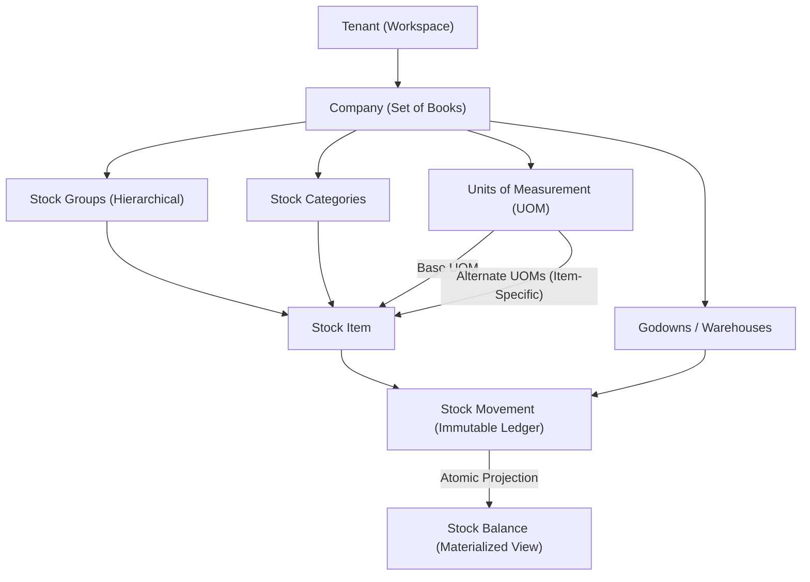

# TallyVeridexERP — Phase 3: Core Inventory & Stock Foundation Architecture

## 1. Subsystem Overview

The **Core Inventory Subsystem** in TallyVeridexERP establishes a multi-tenant, multi-company stock management foundation inspired by TallyPrime's inventory architecture. It is built to support a wide variety of business profiles (General Trading, Hardware Retail, Grocery/Kirana, Wholesale Distribution, Restaurant/Hospitality, and Manufacturing) with rigorous financial safeguards.

### Core Architecture Pillars

1. **Strict Company-Level Isolation**:
   Every inventory master (Stock Groups, Stock Categories, Units of Measurement, Godowns, Stock Items) and transactional record (Stock Movements, Stock Balances) is partitioned by `{ tenant_id, company_id }`. Cross-company data leaks and cross-tenant tampering are prohibited at the API, model, and database index levels.

2. **Immutable Append-Only Movement Ledger**:
   Unlike legacy inventory packages that perform mutable row updates or in-place destructive quantity edits, TallyVeridexERP uses an **immutable append-only ledger** (`StockMovement`).
   - Every physical stock event, opening count, transfer, or adjustment appends a new `StockMovement` document.
   - Movements are never deleted or mutated.
   - Corrections are processed exclusively through signed compensating reversal entries (`movement_type: 'REVERSAL'`).

3. **Projected Materialized Balances (`StockBalance`)**:
   Stock balances per `{ tenant_id, company_id, stock_item_id, godown_id }` are projected materialized views updated atomically with each movement. The audit reconciliation engine (`rebuildStockBalances`) can reconstruct all balances from scratch by replaying the append-only ledger at any time.

4. **Arbitrary-Precision Multi-UOM Conversion Engine**:
   Stock can be purchased, counted, and sold in alternate units (e.g., BOX, DOZEN, PACK) while maintaining exact quantities in the item's immutable base unit (e.g., PCS). All conversion ratios and quantities are evaluated using `bignumber.js` to eliminate IEEE 754 floating-point drift.

5. **Phase 4 General Ledger Boundary**:
   Opening stock initializes inventory valuation and moving-average cost in the inventory subsystem immediately. Direct double-entry GL suspense posting (e.g., `Dr 1300 Merchandise Inventory / Cr 3999 Opening Balance Equity`) is documented and preserved as an explicit integration boundary for Phase 4.

---

## 2. Multi-Tier Entity Architecture

---

## 3. Stock Movement Lifecycle & Audit Safeguards

### Movement Ingestion Lifecycle

1. **Validation & Resolution**:
   - Verify `tenant_id` and `company_id` match the authenticated session.
   - Verify target `StockItem` and `Godown` exist, belong to the company, and are in `ACTIVE` status.
   - If movement UOM differs from item base UOM, resolve conversion factor via `uomConversionService` and compute `base_quantity`.

2. **Idempotency Check**:
   - Every movement requires an `idempotency_key` unique per `{ tenant_id, company_id }`.
   - For Opening Stock, the key `OPN-${stock_item_id}-${godown_id}` guarantees single-execution semantics. Duplicate submissions return `409 Conflict (OPENING_STOCK_ALREADY_POSTED)`.

3. **Atomic Ledger Append & Balance Update**:
   - Transactional append of `StockMovement`.
   - Atomic update of `StockBalance` using atomic MongoDB operations (`$inc` for quantity and total value; moving average recalculation).

4. **Reversal Protocol**:
   - Direct deletions are rejected.
   - `reverseStockMovement` marks original movement as `is_reversed: true` and logs a compensating movement with signed negative `base_quantity` and `total_cost`.

---

## 4. Phase 4 GL Integration Boundary

Opening stock balances recorded in Phase 3 initialize inventory balances and unit valuation. The corresponding double-entry accounting journal is explicitly deferred to Phase 4:

| Action | Current Status (Phase 3) | Phase 4 Delivery |
| :--- | :--- | :--- |
| **Stock Movement Logged** | Active (`OPENING_STOCK`) | Immutable ledger record |
| **Godown Balance Updated** | Active (`StockBalance`) | Projected quantity & moving avg |
| **GL Inventory Asset Entry** | Deferred (`gl_status: 'DEFERRED_TO_PHASE_4'`) | `Dr 1300 Merchandise Inventory` |
| **GL Equity / Suspense Entry**| Deferred (`gl_status: 'DEFERRED_TO_PHASE_4'`) | `Cr 3999 Opening Balance Equity` |

This boundary guarantees clean decoupling between foundational master tracking and later commercial voucher posting workflows.
