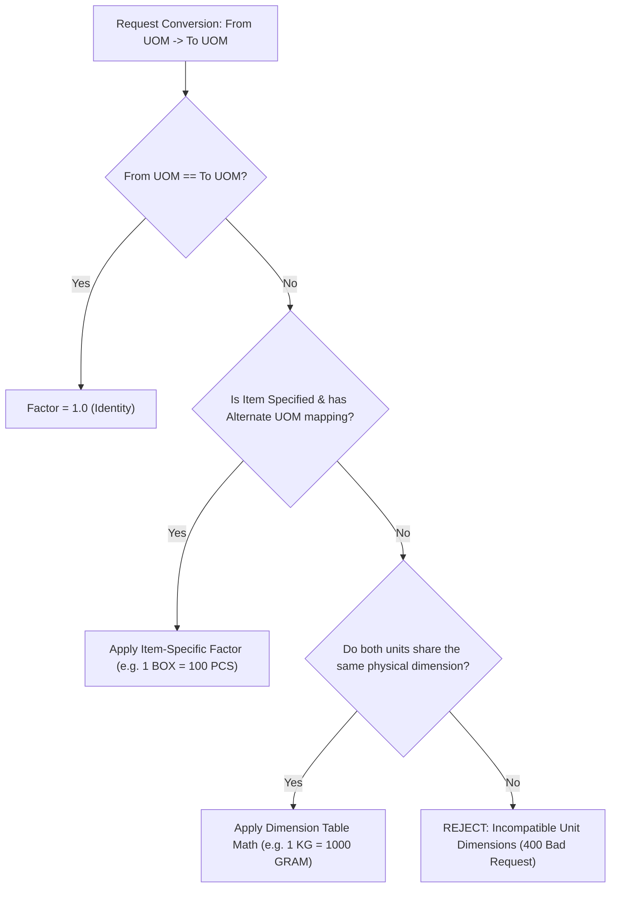

# TallyVeridexERP — Phase 3: Units of Measurement (UOM) and Conversion Rules

## 1. Physical Dimensions and Canonical Standards

In commercial accounting and inventory management, units of measurement represent physical quantities or commercial packages. TallyVeridexERP classifies all units into well-defined physical dimensions:

| Dimension Code | Description | Standard Base Unit | Example Supported Units |
| :--- | :--- | :--- | :--- |
| `COUNT` | Discrete item counts | `PCS` (Pieces) | `PCS`, `DOZEN` (12 PCS) |
| `MASS` | Weight / Mass | `GRAM` (Grams) | `KG` (1000g), `GRAM` (1g), `TON` (1,000,000g) |
| `VOLUME` | Liquid / Gas Volume | `ML` (Milliliters) | `LTR` (1000ml), `ML` (1ml) |
| `LENGTH` | Linear Distance | `MTR` (Meters) | `MTR` (1m), `CM` (0.01m), `MM` (0.001m), `FT` (0.3048m) |
| `PACKAGING` | Item-specific packaging | Item-specific | `BOX`, `PACK`, `CARTON`, `BAG`, `BUNDLE` |
| `CUSTOM` | Business-defined arbitrary unit | Custom | Custom units |

---

## 2. Universal Seeding Standards

When any company is created or initialized, the system automatically provisions 8 canonical system-standard UOM records:

```javascript
[
  { unit_code: 'PCS',   unit_name: 'Pieces',    unit_type: 'COUNT',     decimal_places: 0, is_system_standard: true },
  { unit_code: 'BOX',   unit_name: 'Box',       unit_type: 'PACKAGING', decimal_places: 0, is_system_standard: true },
  { unit_code: 'DOZEN', unit_name: 'Dozen',     unit_type: 'COUNT',     decimal_places: 0, is_system_standard: true },
  { unit_code: 'KG',    unit_name: 'Kilogram',  unit_type: 'MASS',      decimal_places: 3, is_system_standard: true },
  { unit_code: 'GRAM',  unit_name: 'Gram',      unit_type: 'MASS',      decimal_places: 2, is_system_standard: true },
  { unit_code: 'LTR',   unit_name: 'Liter',     unit_type: 'VOLUME',    decimal_places: 3, is_system_standard: true },
  { unit_code: 'ML',    unit_name: 'Milliliter',unit_type: 'VOLUME',    decimal_places: 2, is_system_standard: true },
  { unit_code: 'MTR',   unit_name: 'Meter',     unit_type: 'LENGTH',    decimal_places: 3, is_system_standard: true }
]
```

---

## 3. The Multi-Tier Conversion Resolution Hierarchy

When converting between two units (such as transaction UOM to stock item base UOM), the conversion engine evaluates in strict priority:



### Why Packaging Units (`BOX`, `PACK`, `CARTON`) Require Item-Specific Ratios
Unlike mass where `1 KG` is universally `1000 GRAMS`, commercial packaging varies per product:
- **Product A (M8 Bolts)**: 1 BOX = 10 PCS.
- **Product B (Drywall Screws)**: 1 BOX = 100 PCS.
- **Product C (Tiles)**: 1 BOX = 25 SQFT.

Therefore, packaging units cannot have a static global conversion factor. They **must** be declared on the `StockItem.uom_conversions` list. Attempting to convert between a packaging unit and a base unit without item context returns an explicit validation error.

---

## 4. Decimal Precision & Rounding Rules

1. All factor lookups and multiplications use `bignumber.js` arbitrary-precision arithmetic.
2. Floating-point binary representation errors (e.g., `0.1 + 0.2 = 0.30000000000000004`) are strictly prevented.
3. Intermediate conversion factors are stored as exact decimal strings up to 6 decimal places (`0.000001`).
4. Resulting base quantities are rounded to the `decimal_places` declared on the target `UnitOfMeasurement` document using `ROUND_HALF_UP` (banker's standard rounding).
